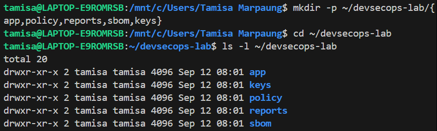
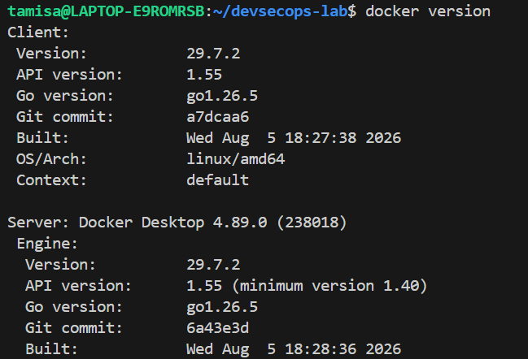
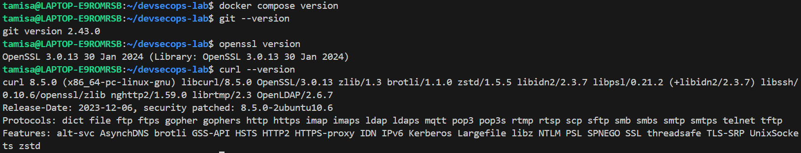
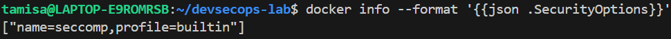

# Laporan Praktikum Workshop DevOps

## Pertemuan 1 — Fondasi Teoretis dan Kerangka Kerja DevSecOps

| | |
|---|---|
| **Nama** | Tamisa Ulinda Marpaung |
| **NRP** | 3126640048 |
| **Mata Kuliah** | Workshop DevOps |
| **Program Studi** | D4 Lanjut Jenjang Teknik Informatika |
| **Institusi** | Politeknik Elektronika Negeri Surabaya |
| **Tahun** | 2026 |

📄 Versi PDF: [laporan.pdf](laporan.pdf)

---

## Daftar Isi

1. [Tujuan Pembelajaran](#1-tujuan-pembelajaran)
2. [Dasar Teori Singkat](#2-dasar-teori-singkat)
3. [Pelaksanaan Praktikum](#3-pelaksanaan-praktikum)
4. [Jawaban Evaluasi dan Latihan Mandiri](#4-jawaban-evaluasi-dan-latihan-mandiri)
5. [Catatan](#5-catatan)
6. [Kesimpulan](#6-kesimpulan)

---

## 1. Tujuan Pembelajaran

a. Menyiapkan satu folder khusus yang aman untuk mengerjakan semua tugas lab DevSecOps.

b. Mencatat versi aplikasi yang dipakai (Docker, Git, dll) agar hasil praktikum bisa dilacak dan diulang jika terjadi error.

c. Mengecek perlindungan keamanan bawaan dari Docker di laptop.

## 2. Dasar Teori Singkat

DevOps merupakan pendekatan yang menggabungkan proses *development* dan *operations* untuk mempercepat dan mempermudah proses pengembangan hingga penerapan perangkat lunak. DevOps menerapkan kolaborasi, otomatisasi, serta umpan balik secara terus-menerus dalam proses pengembangan perangkat lunak. Salah satu penerapannya adalah CI/CD, yaitu proses mengintegrasikan, menguji, dan menyiapkan perangkat lunak agar dapat dirilis secara lebih konsisten. Dalam perkembangannya, DevOps juga dapat diintegrasikan dengan keamanan melalui DevSecOps, sehingga aspek keamanan diperhatikan sejak awal hingga perangkat lunak digunakan.

## 3. Pelaksanaan Praktikum

### A. Penyiapan Folder Kerja

Membuat tempat khusus agar *file* aplikasi, laporan, dan kunci rahasia tidak tercampur dan tetap aman.

```bash
mkdir -p ~/devsecops-lab/{app,policy,reports,sbom,keys}
cd ~/devsecops-lab
ls -l ~/devsecops-lab
```



Perintah `ls -l` berfungsi mengecek hak akses. Munculnya tulisan `drwxr-xr-x` adalah bukti bahwa folder tersebut aman; `rwx` (*read, write, execute*) menandakan sebagai pemilik yang bebas menambah atau menghapus file di sana, sementara pengguna lain hanya bisa melihat.

### B. Pencatatan Versi Aplikasi (Baseline)

Mengecek versi alat yang terinstal untuk memastikan lingkungan kerja sudah siap.

```bash
docker version
docker compose version
git --version
openssl version
curl --version
```





Versi yang digunakan:

| Tool | Versi |
|---|---|
| Docker | 29.7.2 |
| Git | 2.43.0 |
| OpenSSL | 3.0.13 |
| curl | 8.5.0 |

### C. Pengecekan Fitur Keamanan Docker

Melihat mekanisme perlindungan bawaan sistem menggunakan perintah:

```bash
docker info --format '{{json .SecurityOptions}}'
```



Docker di laptop sudah otomatis dilindungi oleh fitur bernama **seccomp** (*Secure Computing*). Fitur ini bertindak seperti satpam yang membatasi agar aplikasi apa pun yang jalan di dalam container tidak bisa sembarangan membobol atau merusak sistem operasi utama laptop.

## 4. Jawaban Evaluasi dan Latihan Mandiri

**a. Mengapa DevSecOps tidak dapat direduksi menjadi penambahan scanner pada pipeline?**

Karena DevSecOps tidak hanya tentang penggunaan security scanner, tetapi merupakan pendekatan yang mengintegrasikan keamanan ke seluruh proses pengembangan, mulai dari perencanaan, coding, build, pengujian, deployment, hingga sistem berjalan. Selain itu, DevSecOps juga membutuhkan perubahan proses, pembagian tanggung jawab, kebijakan, dan budaya kerja.

**b. Evidence apa yang membedakan klaim kontrol dari kontrol yang benar-benar terverifikasi?**

Kontrol yang benar-benar terverifikasi harus memiliki evidence yang dapat diperiksa dan ditelusuri, misalnya hasil SAST/SCA, SBOM, attestation, hasil evaluasi kebijakan, dan log deployment. Evidence tersebut sebaiknya memiliki informasi seperti commit, pipeline run, image digest, waktu, versi tools, konfigurasi aturan, dan keputusan waiver, sehingga tidak hanya berupa klaim bahwa kontrol sudah dilakukan.

**c. Bagaimana shared responsibility memengaruhi ownership risiko dan tindak lanjut temuan?**

Shared responsibility berarti tanggung jawab keamanan dibagi sesuai peran, bukan berarti semua orang melakukan pekerjaan yang sama. Misalnya, developer bertanggung jawab memperbaiki temuan, security engineer membuat aturan dan threat model, sedangkan operator menangani keamanan saat sistem berjalan. Dengan pembagian ownership yang jelas, setiap temuan memiliki pihak yang bertanggung jawab untuk menindaklanjuti dan tidak terjadi kondisi saling menunggu.

## 5. Catatan

Pengembangan TI harus selalu berangkat dari kebutuhan bisnis. Kebutuhan pelanggan yang terus berubah menuntut proses bisnis menjadi lebih adaptif (*Agile*). Hal ini melatarbelakangi lahirnya DevOps untuk menyatukan tim pembuat aplikasi (*Development*) dan tim operasional (*Operations*) guna mempercepat rilis aplikasi tanpa hambatan prosedural. Namun, kecepatan rilis ini memunculkan kerentanan baru, sehingga diperlukan DevSecOps yang menggeser keamanan lebih awal (*Shift Left*). Keamanan tidak lagi hanya diuji di akhir, melainkan disisipkan pada seluruh tahapan pengembangan perangkat lunak (mulai dari Plan, Code, Build, Test, Deploy, Operate, hingga Monitor).

## 6. Kesimpulan

Berdasarkan materi dan praktikum yang telah dilakukan, dapat disimpulkan bahwa DevOps merupakan pendekatan yang menggabungkan proses development dan operations untuk membuat pengiriman perangkat lunak menjadi lebih cepat dan teratur. Agar kecepatan tersebut tidak menjadi kelemahan, penerapan DevSecOps diperlukan. Langkah dasar seperti pembatasan hak akses direktori kerja dan pengaktifan fitur perlindungan tingkat kernel (seccomp) pada Docker memastikan bahwa sistem sudah terproteksi sejak dari infrastruktur paling awal.

---

⬅️ [Kembali ke daftar praktikum](../README.md)
