# Laporan Praktikum Workshop DevOps

## Pertemuan 2 — Konsep Container dan Instalasi Docker

| | |
|---|---|
| **Nama** | Tamisa Ulinda Marpaung |
| **NRP** | 3126640048 |
| **Mata Kuliah** | Workshop DevOps |
| **Program Studi** | D4 Lanjut Jenjang Teknik Informatika |
| **Institusi** | Politeknik Elektronika Negeri Surabaya |
| **Tahun** | 2026 |

📄 Versi PDF: [laporan.pdf](laporan.pdf)

---

## Daftar Isi

1. [Tujuan Pembelajaran](#1-tujuan-pembelajaran)
2. [Dasar Teori Singkat](#2-dasar-teori-singkat)
3. [Pelaksanaan Praktikum: Baseline Laboratorium](#3-pelaksanaan-praktikum-baseline-laboratorium)
4. [Jawaban Evaluasi dan Latihan Mandiri](#4-jawaban-evaluasi-dan-latihan-mandiri)
5. [Kesimpulan](#5-kesimpulan)

---

## 1. Tujuan Pembelajaran

- Memahami perbedaan mendasar antara model isolasi Virtual Machine (VM) dan Container.
- Menjalankan container pertama, memeriksa log aktivitas, dan masuk ke sistem operasi di dalam container secara interaktif.
- Membangun image aplikasi web custom secara mandiri dan deklaratif menggunakan Dockerfile.

## 2. Dasar Teori Singkat

*Containerization* adalah metode mengemas aplikasi beserta dependensinya agar dapat berjalan konsisten di berbagai lingkungan kerja. Berbeda dengan mesin virtual (VM) yang harus meniru seluruh perangkat keras dan memuat sistem operasi utuh (*guest OS*), container hanya memvirtualisasikan ruang lingkup proses dengan cara berbagi kernel dari OS utama (*host*). Docker memanfaatkan fitur kernel Linux seperti **namespace** untuk membatasi visibilitas proses dan **cgroup** untuk membatasi konsumsi sumber daya (CPU/RAM).

## 3. Pelaksanaan Praktikum: Baseline Laboratorium

### 3.1 Penyiapan Folder Kerja

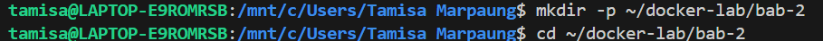

### 3.2 Menjalankan Container Nginx & Akses Interaktif OS

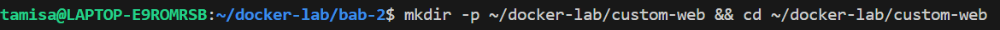

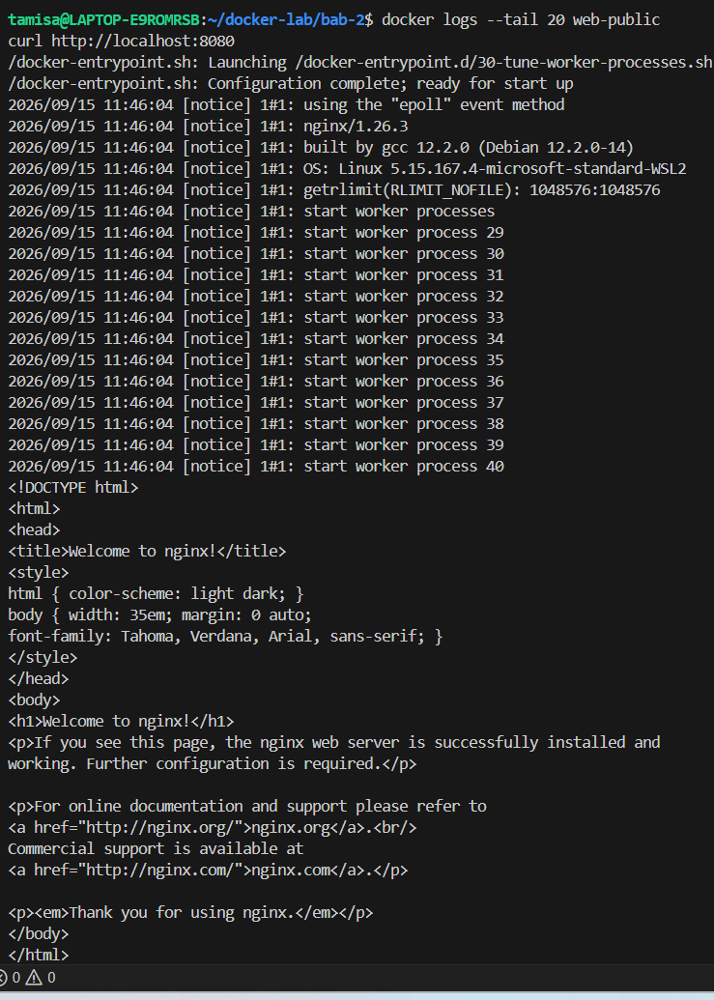

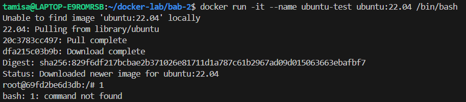

### 3.3 Pembuatan Custom Web dengan Dockerfile

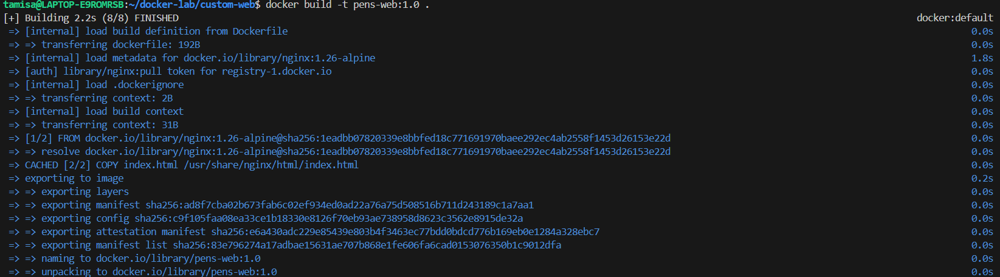

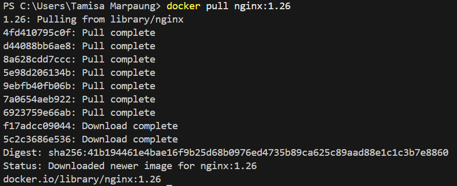

Jalankan container:

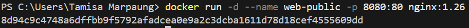

Cek apakah container sudah berjalan:

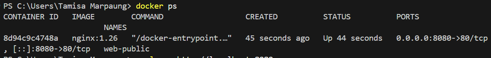

Pengujian akses web Nginx:

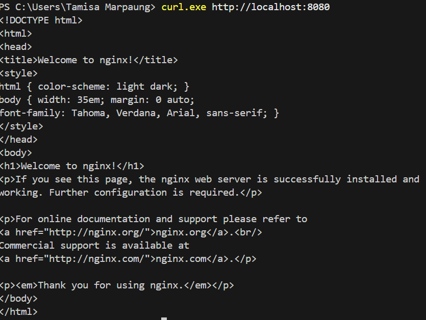

Pembuatan web:

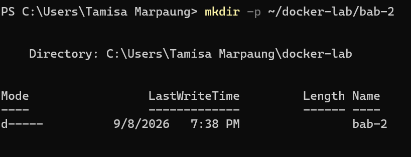

Pembuatan file HTML:

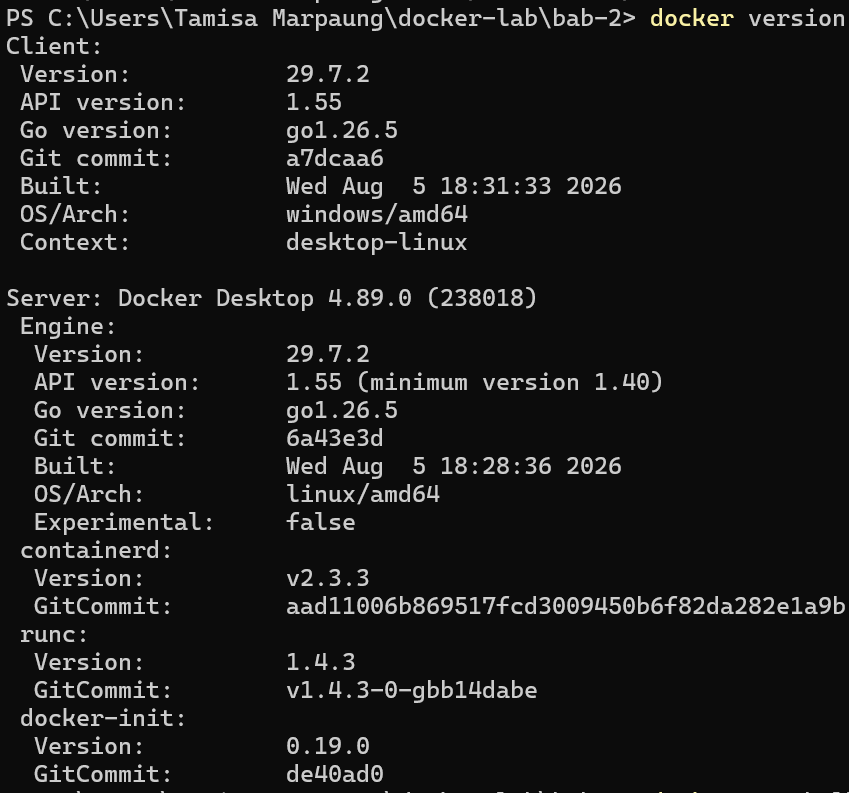

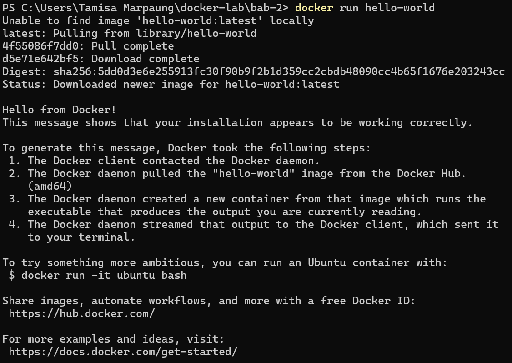

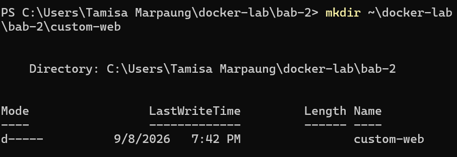

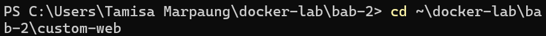

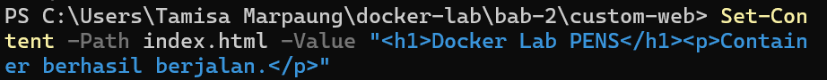

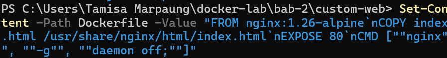

Pembuatan custom web dan build Dockerfile:

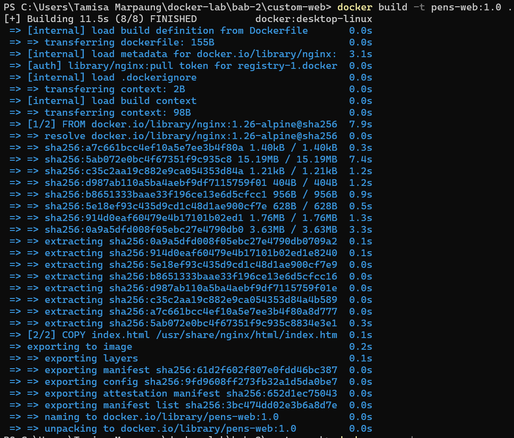

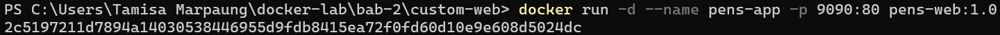

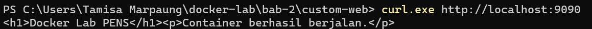

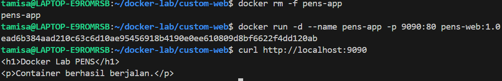

## 4. Jawaban Evaluasi dan Latihan Mandiri

**1. Mengapa DevSecOps tidak dapat direduksi menjadi penambahan scanner pada pipeline?**

Karena DevSecOps adalah sistem sosio-teknis. Menambahkan scanner tanpa proses triase, batas toleransi risiko (*security gate*), dan kejelasan kepemilikan hanya akan menghasilkan antrean masalah dan peringatan yang diabaikan (*alert fatigue*). DevSecOps membutuhkan integrasi budaya, standar operasional, dan kolaborasi antar fungsi.

**2. Evidence apa yang membedakan klaim kontrol dari kontrol yang benar-benar terverifikasi?**

Klaim kontrol umumnya bersifat teoretis atau berbasis dokumentasi manual. Kontrol yang terverifikasi menghasilkan *evidence* (bukti) yang dapat dibaca oleh mesin dan diaudit, seperti laporan SARIF, JUnit XML, SBOM, *image signature*, dan log penyebaran yang mencakup identitas, waktu, versi alat, serta keputusan *waiver*.

**3. Bagaimana shared responsibility memengaruhi ownership risiko dan tindak lanjut temuan?**

*Shared responsibility* tidak berarti semua orang melakukan hal yang sama, melainkan mendistribusikan tanggung jawab sesuai konteks dan keahlian untuk mencegah area abu-abu. *Product owner* memegang *ownership* risiko, developer bertanggung jawab menerapkan perbaikan pada kode, *security* menyediakan model ancaman dan platform pengujian, serta *operations* mengelola deteksi lingkungan.

## 5. Kesimpulan

Implementasi DevSecOps menuntut lebih dari sekadar otomatisasi alat; ia membutuhkan penyelarasan sistem sosio-teknis yang mengutamakan umpan balik keamanan berkelanjutan. Perekaman *baseline* laboratorium di awal sangat penting untuk memastikan identifikasi risiko, eksekusi kontrol keamanan, dan pengumpulan bukti sistem yang konsisten untuk eksperimen selanjutnya.

---

⬅️ [Kembali ke daftar praktikum](../README.md)
