# Laporan Praktikum Workshop DevOps

## Pertemuan 3 — Docker Network, Volume, Bind Mount, dan Compose

| | |
|---|---|
| **Nama** | Tamisa Ulinda Marpaung |
| **NRP** | 3126640048 |
| **Mata Kuliah** | Workshop DevOps |
| **Program Studi** | D4 Lanjut Jenjang Teknik Informatika |
| **Institusi** | Politeknik Elektronika Negeri Surabaya |
| **Tahun** | 2026 |

📄 Versi PDF: [laporan.pdf](laporan.pdf)

---

## Daftar Isi

1. [Tujuan Pembelajaran](#1-tujuan-pembelajaran)
2. [Dasar Teori Singkat](#2-dasar-teori-singkat)
3. [Alat dan Lingkungan](#3-alat-dan-lingkungan)
4. [Langkah Praktikum](#4-langkah-praktikum)
5. [Hasil Pengujian](#5-hasil-pengujian)
6. [Analisis Risiko](#6-analisis-risiko)
7. [Jawaban Evaluasi dan Latihan Mandiri](#7-jawaban-evaluasi-dan-latihan-mandiri)
8. [Kesimpulan](#8-kesimpulan)

---

## 1. Tujuan Pembelajaran

1. Membuat *user-defined bridge network* dan membuktikan *name resolution* antar container.
2. Membedakan volume, bind mount, dan tmpfs dari sisi persistensi, portabilitas, dan keamanan.
3. Menulis file Compose untuk aplikasi multi-container yang memiliki service, network, volume, dan healthcheck.
4. Mengelola lifecycle aplikasi dengan `docker compose up`, `ps`, `logs`, `stop`, `start`, `down`, dan `down -v`.

## 2. Dasar Teori Singkat

Arsitektur aplikasi modern umumnya memecah layanan ke dalam beberapa komponen yang saling terisolasi (misalnya: web server, application backend, dan database). Docker Network menyediakan graf keterjangkauan (*reachability*) antar komponen ini. Penggunaan *user-defined bridge* memungkinkan setiap container berkomunikasi menggunakan nama layanannya (contoh: `app` atau `db`) tanpa perlu mengetahui IP statis masing-masing.

Untuk manajemen data, container pada dasarnya bersifat volatil (*ephemeral*). Oleh karena itu, diperlukan mekanisme eksternal untuk menyimpan *state*:

**a. Volume**
Dikelola penuh oleh Docker (berada di `/var/lib/docker/volumes`), sangat direkomendasikan untuk persistensi data berkelanjutan seperti database.

**b. Bind Mount**
Memetakan path secara langsung dari sistem file host ke dalam container. Sangat efisien untuk memuat kode sumber atau konfigurasi secara langsung selama fase development, namun sangat bergantung pada struktur sistem host.

Docker Compose menyatukan semua entitas ini (layanan, jaringan, dan storage) ke dalam satu representasi deklaratif berbasis YAML, memudahkan orkestrasi dan penerapan infrastruktur sebagai kode (*Infrastructure as Code*).

## 3. Alat dan Lingkungan

| Komponen | Hasil Identifikasi |
|---|---|
| Operating system | Ubuntu 24.04.1 LTS (WSL2 pada Windows) |
| Kernel | Linux 5.15.167.4-microsoft-standard-WSL2 x86_64 |
| Pengguna eksekusi | tamisa |
| Direktori kerja | `/home/tamisa/docker-lab/bab-3` |
| Docker Compose | v2 (terverifikasi berjalan) |
| Layanan Web/Proxy | Nginx (`bab-3-web-1`) aktif pada port 8081 |

## 4. Langkah Praktikum

### 4.1 Persiapan Struktur Direktori dan File Pendukung

Pembuatan struktur folder dilakukan untuk mengisolasi konfigurasi:

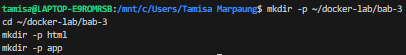

### 4.2 Pembuatan Konfigurasi Deklaratif

Pada tahapan ini, didefinisikan 6 file utama yang membentuk layanan aplikasi backend dan frontend.

**a. `compose.yaml`**

Mendefinisikan 3 service (`web` [Nginx], `app` [Flask], dan `db` [PostgreSQL]), 2 network (`frontend`, `backend`), dan 1 volume (`pg-data`).

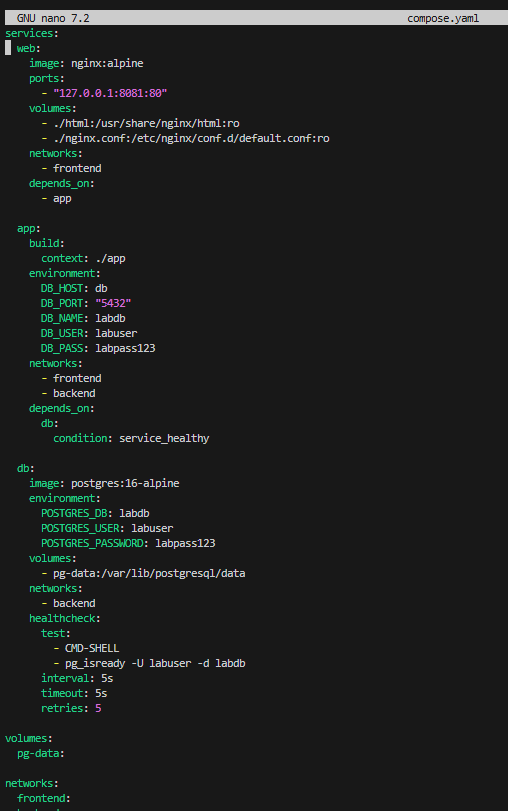

**b. `nginx.conf`**

Konfigurasi reverse proxy Nginx yang mengarahkan trafik ke `app:5000` dan mendefinisikan static route ke `/usr/share/nginx/html`.

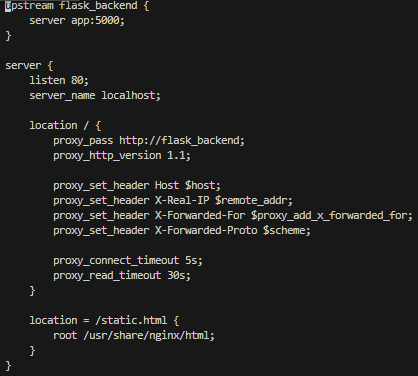

**c. Berkas `html/static.html`**

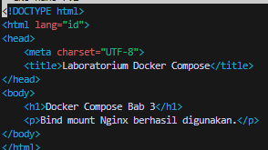

**d. Berkas Dependensi Python (`app/requirements.txt`)**

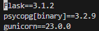

**e. Berkas Aplikasi Backend (`app/app.py`)**

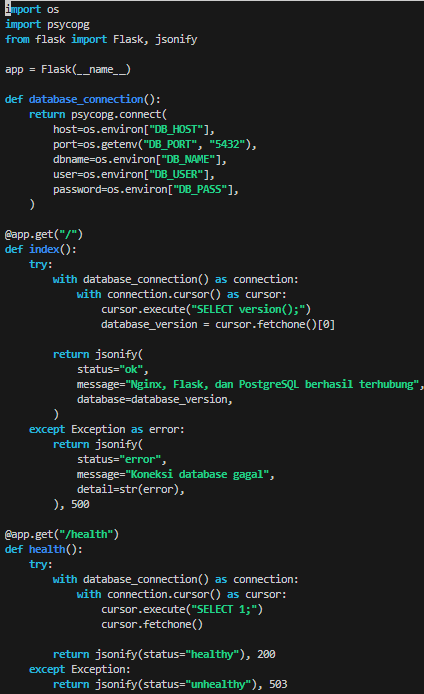

**f. Berkas `app/Dockerfile`**

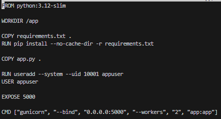

### 4.3 Hasil Pengujian dan Verifikasi Skenario

Melakukan validasi awal dan menjalankan stack secara background:

**a. `docker compose config`**

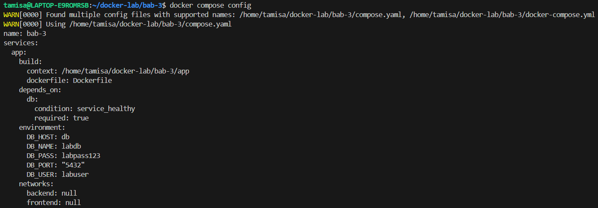

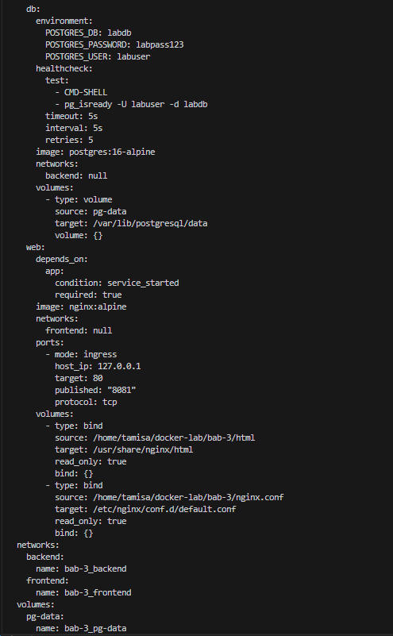

**b. `docker compose config --services`**

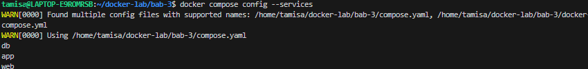

**c. `docker compose up -d --build`**

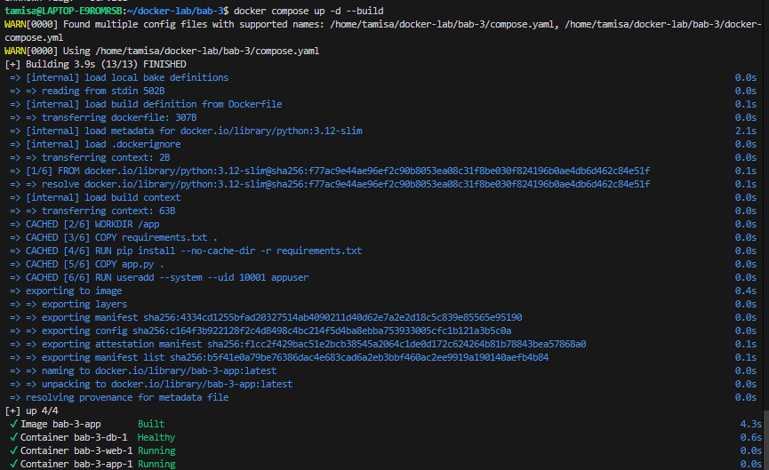

## 5. Hasil Pengujian

### 5.1 Hasil Perintah Utama

| Pemeriksaan | Hasil Aktual | Status |
|---|---|---|
| Validasi `compose.yaml` | Menampilkan detail parsed config tanpa error sintaks | ✅ Terpenuhi |
| Deployment service | Container `db`, `app`, `web` berhasil dibentuk | ✅ Terpenuhi |
| Status `docker compose ps` | web (Up), app (Up), db (Up - healthy) | ✅ Terpenuhi |
| Uji API Flask (`/`) | Menampilkan JSON database version | ✅ Terpenuhi |
| Uji healthcheck (`/health`) | HTTP 200 OK, JSON `{"status": "healthy"}` | ✅ Terpenuhi |

### 5.2 Bukti Output

**1. Output Status Container (`docker compose ps`)**

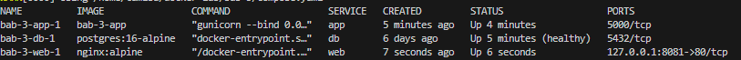

**2. Output Healthcheck API (`curl -i http://localhost:8081/health`)**

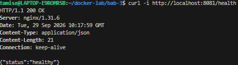

**3. Output Koneksi Database Utama (`curl http://localhost:8081/`)**

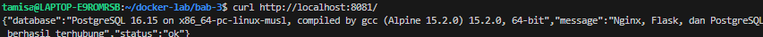

**4. Output Halaman Statis Nginx (`curl http://localhost:8081/static.html`)**

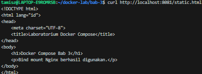

### 5.3 Penghentian Stack Compose

Perintah `docker compose down` digunakan untuk menghentikan dan menghapus seluruh kontainer (`web`, `app`, `db`) beserta jaringan virtual privat (`frontend`, `backend`) yang telah dibentuk sebelumnya, tanpa merusak data persisten yang tersimpan di dalam volume.

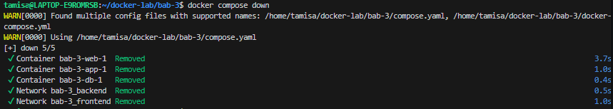

Perintah `docker compose down -v` bersifat destruktif karena selain menghapus kontainer dan jaringan, parameter `-v` juga akan memusnahkan named volume (`pg-data`) secara permanen, sehingga seluruh basis data dan data riwayat di dalamnya ikut terhapus.

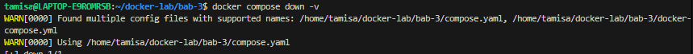

## 6. Analisis Risiko

### a. Risiko Keamanan dan Rekomendasi

**1) Risiko Kredensial Plaintext**

Menuliskan `DB_PASS` (`labpass123`) secara hardcode di `compose.yaml` sangat rentan jika file ini terunggah ke version control. Rekomendasinya adalah menggunakan Docker Secrets atau file `.env` terpisah yang tidak di-commit.

**2) Risiko Bind Mount Konfigurasi**

Nginx memuat `nginx.conf` secara langsung dari sistem host. Jika file diubah oleh pihak tidak bertanggung jawab di level OS host, proxy server dapat disusupi. Disarankan menambahkan flag `:ro` (read-only) secara ketat pada pemetaan volume production.

## 7. Jawaban Evaluasi dan Latihan Mandiri

**1) Mengapa user-defined bridge lebih baik dari default bridge?**

User-defined bridge menyediakan resolusi nama domain (DNS internal) otomatis berdasarkan nama container atau service, memungkinkan aplikasi terhubung tanpa perlu mencatat IP address yang dapat berubah. Ia juga memberikan isolasi jaringan yang lebih baik dibandingkan default bridge.

**2) Risiko keamanan bind mount**

Container (terutama yang berjalan sebagai root) berpotensi memiliki akses tulis (*write access*) secara langsung ke sistem file host. Jika diubah atau dihapus oleh proses berbahaya di dalam container, ini dapat merusak integritas host.

**3) Perbedaan `docker compose down` dan `down -v`**

`docker compose down` hanya menghentikan dan menghapus container dan network, sedangkan `docker compose down -v` juga akan menghapus/mendestruksi named volume (termasuk data database yang tersimpan di dalamnya).

**4) Kapan menggunakan `depends_on` dengan healthcheck**

Ketika layanan dependen (seperti Flask) mutlak membutuhkan layanan dasar (seperti PostgreSQL) untuk tidak hanya "menyala", tetapi "sudah siap menerima koneksi". `depends_on` biasa hanya memastikan container dijalankan lebih dulu, bukan berarti proses di dalamnya sudah siap.

**5) Strategi backup volume database produksi**

Tidak cukup hanya mengandalkan named volume. Strategi backup harus mencakup penggunaan logical dump (seperti `pg_dump` secara berkala), pengambilan snapshot volume pada level host/storage, retensi, enkripsi cadangan, dan yang terpenting: melakukan uji coba restore secara berkala.

## 8. Kesimpulan

Praktikum implementasi multi-container menggunakan Docker Compose sukses dilaksanakan. Penggunaan user-defined network menjembatani Nginx, Flask, dan PostgreSQL. Praktikum membuktikan bahwa manajemen lingkungan DevSecOps dengan Compose membutuhkan perencanaan isolasi jaringan, pemilihan tipe storage yang tepat, dan pengelolaan secret yang aman demi mendekati standar lingkungan produksi.

---

⬅️ [Kembali ke daftar praktikum](../README.md)
