# Laporan Praktikum Workshop DevOps

## Pertemuan 4 — Web Service Container: Apache, Nginx, Reverse Proxy, dan TLS

| | |
|---|---|
| **Disusun oleh** | Dafa Ahmad Fahrisi (3126640010) Rahadyan Danang Susetyo Pranawa (3126640054) Tamisa Ulinda Marpaung (3126640048) |
| **Mata Kuliah** | Workshop DevOps |
| **Program Studi** | D4 Lanjut Jenjang Teknik Informatika |
| **Institusi** | Politeknik Elektronika Negeri Surabaya |
| **Tahun** | 2026 |

📄 Versi PDF: [laporan.pdf](laporan.pdf)

---

## Daftar Isi

1. [Tujuan Praktikum](#1-tujuan-praktikum)
2. [Dasar Teori](#2-dasar-teori)
3. [Alat dan Lingkungan](#3-alat-dan-lingkungan)
4. [Langkah Praktikum](#4-langkah-praktikum)
5. [Hasil Pengujian dan Analisis](#5-hasil-pengujian-dan-analisis)
6. [Evaluasi dan Latihan Mandiri](#6-evaluasi-dan-latihan-mandiri)
7. [Kesimpulan](#7-kesimpulan)

---

## 1. Tujuan Praktikum

Praktikum Bab 4 bertujuan memahami pengelolaan web service berbasis container menggunakan Apache HTTP Server dan Nginx. Praktikum mencakup pembuatan konfigurasi web server, virtual host, reverse proxy, penerapan TLS self-signed, serta pembacaan access log dan error log melalui bind mount. Berdasarkan materi Bab 4, web service dipandang sebagai *boundary* antara client, jaringan, dan logika aplikasi sehingga konfigurasi web layer juga menjadi bagian dari aspek keamanan dan operasional.

Kompetensi yang diharapkan dari praktikum ini adalah sebagai berikut:

- a. Menjalankan Apache dan Nginx dengan konfigurasi custom.
- b. Membuat virtual host berbasis nama.
- c. Mengarahkan request melalui Nginx ke backend service menggunakan reverse proxy.
- d. Menerapkan HTTPS menggunakan sertifikat self-signed.
- e. Melakukan verifikasi service container.
- f. Melakukan troubleshooting terhadap web service dan container.

## 2. Dasar Teori

Apache HTTP Server dan Nginx merupakan web server yang dapat digunakan sebagai origin server, penyaji file statis, maupun reverse proxy. Pada lingkungan container, konfigurasi dapat dipasang melalui bind mount atau image turunan sehingga konfigurasi lebih mudah dipisahkan dari aplikasi dan dapat dijalankan kembali secara konsisten. Apache menggunakan direktori konfigurasi dan document root yang berbeda dari Nginx, sedangkan Nginx memiliki fungsi `proxy_pass` yang dapat digunakan untuk meneruskan request ke service internal.

### 2.1 Perbandingan

**a. Apache HTTP Server**

Apache HTTP Server merupakan web server yang dikenal memiliki arsitektur modular dan fleksibel. Apache menyediakan berbagai modul yang dapat digunakan untuk menyesuaikan fungsi web server sesuai kebutuhan, termasuk modul untuk autentikasi, SSL/TLS, dan reverse proxy. Dalam pengelolaan virtual host, Apache menggunakan konfigurasi `<VirtualHost>` sehingga beberapa website dapat dijalankan pada satu server. Apache cocok digunakan sebagai web server yang membutuhkan fleksibilitas konfigurasi dan dukungan terhadap berbagai modul serta kebutuhan aplikasi.

**b. Nginx**

Nginx merupakan web server yang menggunakan arsitektur *event-driven* dan banyak digunakan untuk menangani koneksi secara efisien, terutama ketika jumlah koneksi simultan cukup besar. Selain menyajikan konten statis, Nginx memiliki kemampuan yang kuat sebagai reverse proxy, load balancer, dan terminasi TLS. Konfigurasi virtual host pada Nginx dilakukan melalui blok `server` dengan `server_name`, sedangkan penerusan request ke backend dilakukan menggunakan `proxy_pass`. Dalam arsitektur praktikum, Nginx dapat ditempatkan sebagai lapisan depan yang menerima request dari client, melakukan routing dan TLS termination, kemudian meneruskan request ke Apache atau service backend melalui jaringan internal.

### 2.2 Mind Map

**a. Manajemen TLS, Penyimpanan Private Key, TLS Offloading**

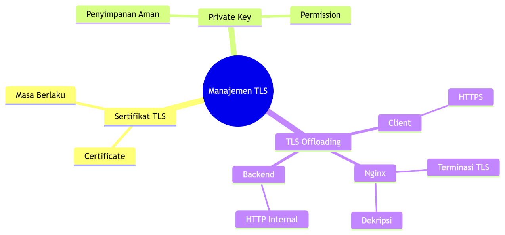

Mind map Manajemen TLS menggambarkan tiga komponen utama dalam penerapan keamanan komunikasi menggunakan TLS, yaitu sertifikat TLS, private key, dan TLS offloading.

- **Sertifikat TLS** digunakan untuk mengidentifikasi server dan memungkinkan komunikasi antara client dan server dilakukan melalui HTTPS. Sertifikat memiliki masa berlaku sehingga perlu diperhatikan proses pembaruan (*renewal*) agar koneksi HTTPS tetap dapat digunakan.
- **Private key** merupakan bagian penting dalam keamanan TLS karena digunakan dalam proses kriptografi dan harus disimpan secara aman. Akses terhadap private key perlu dibatasi menggunakan permission yang sesuai dan tidak seharusnya disimpan secara sembarangan, misalnya dimasukkan langsung ke repository kode.
- **TLS offloading** merupakan mekanisme ketika proses terminasi TLS dilakukan pada server perantara seperti Nginx. Client melakukan koneksi HTTPS ke Nginx, kemudian Nginx menangani proses TLS dan meneruskan request ke backend melalui jaringan internal. Dengan demikian, pengelolaan TLS dapat dipusatkan pada Nginx, sedangkan backend seperti Apache atau Flask tidak perlu menangani terminasi TLS secara langsung.

**b. Cara Kerja Reverse Proxy, Routing, dan Filter Keamanan**

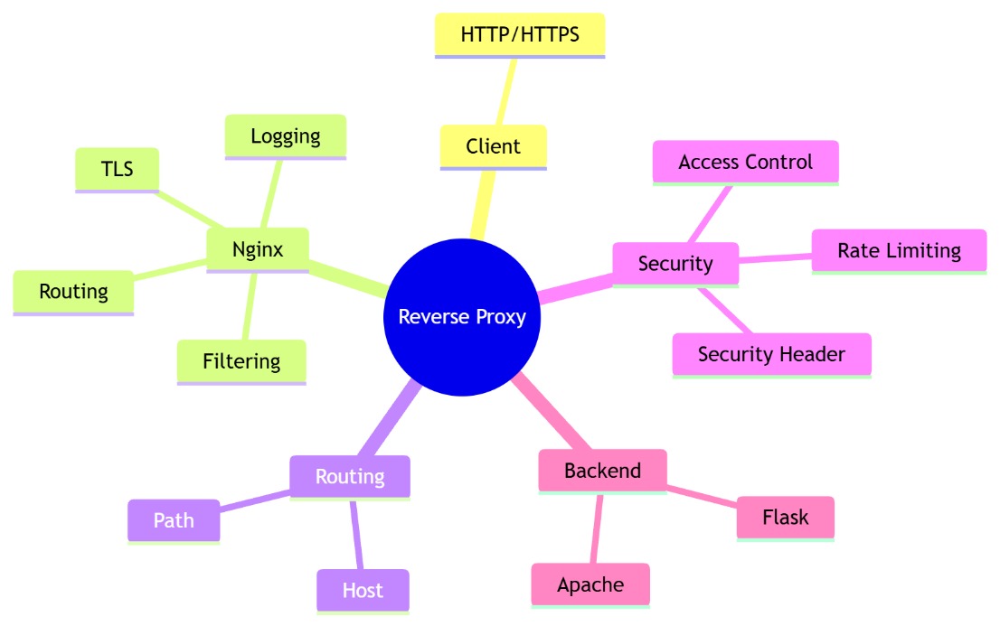

Mind map Reverse Proxy menjelaskan alur komunikasi antara client, Nginx, dan backend. Client dapat mengirimkan request melalui HTTP atau HTTPS yang kemudian diterima oleh Nginx.

- **Client (Pengguna/Aplikasi Luar)** — Client merupakan pihak luar yang mengirimkan permintaan (*request*) akses layanan web atau API menggunakan protokol HTTP/HTTPS. Dalam arsitektur reverse proxy, client tidak pernah berhubungan langsung dengan server backend, melainkan mengirim seluruh lalu lintas data ke pintu masuk utama, yaitu Nginx.
- **Nginx** — Nginx berdiri di garda terdepan sebagai perantara yang menerima request client untuk diteruskan ke jaringan internal. Nginx mengelola empat fitur utama: TLS (*SSL Termination*) untuk memproses enkripsi data, *Logging* untuk mencatat aktivitas dan error sistem, *Routing* untuk mengarahkan rute request, serta *Filtering* untuk memblokir lalu lintas berbahaya sebelum menyentuh aplikasi.
- **Routing** — Routing adalah aturan pengarahan request Nginx menuju server backend yang sesuai. Pengarahan ini dilakukan berdasarkan dua kriteria utama: *Path* (berdasarkan direktori/endpoint URL, seperti `/api` atau `/static.html`) dan *Host* (berdasarkan nama domain/subdomain, seperti `app.domain.com` atau `api.domain.com`).
- **Backend** — Server backend (seperti Flask, Node.js/Express, atau Apache) bertugas menjalankan logika bisnis dan pemrosesan data di dalam lingkungan internal yang terisolasi. Layanan ini bersifat tertutup dan tidak pernah mengekspos port-nya ke internet umum, melainkan hanya menerima request yang disaring dan diteruskan (`proxy_pass`) oleh Nginx.
- **Security** — Lapisan keamanan pada proxy berfungsi melindungi backend dari serangan siber. Fiturnya meliputi *Access Control* untuk pembatasan IP/otentikasi, *Rate Limiting* untuk membatasi frekuensi request guna mencegah serangan DoS/brute force, serta *Security Header* untuk menyuntikkan header proteksi browser dari celah Clickjacking dan XSS.

## 3. Alat dan Lingkungan

| Komponen | Hasil Identifikasi |
|---|---|
| Operating system | Ubuntu 24.04.1 LTS (via WSL2) |
| Pengguna eksekusi | tamisa |
| Direktori kerja | `~/docker-lab/bab-4` |
| OpenSSL | OpenSSL 3.0.13 |
| cURL | curl 8.5.0 |
| Docker Compose | Terpasang (v5.5.0), integrasi V2 aktif |
| Base Images | `nginx:alpine`, `httpd:2.4-alpine`, `python:3.12-slim` |

## 4. Langkah Praktikum

### 4.1 Persiapan Direktori dan Keamanan TLS

**a. Menyiapkan struktur folder.**

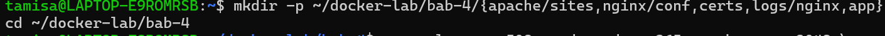

**b. Membuat sertifikat TLS laboratorium dan proteksi hak akses `lab.key`.**

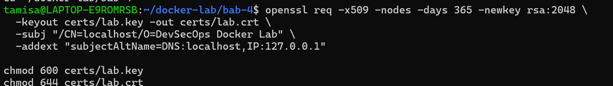

### 4.2 Penyusunan File Konfigurasi

Semua file konfigurasi dibuat dengan teks editor `nano`, mencakup:

**a. `compose.yaml`**

Mengatur orkestrasi 3 service, port mapping, dan isolasi network `web-net`. Nginx hanya dijalankan jika Flask sudah mencapai `condition: service_healthy`.

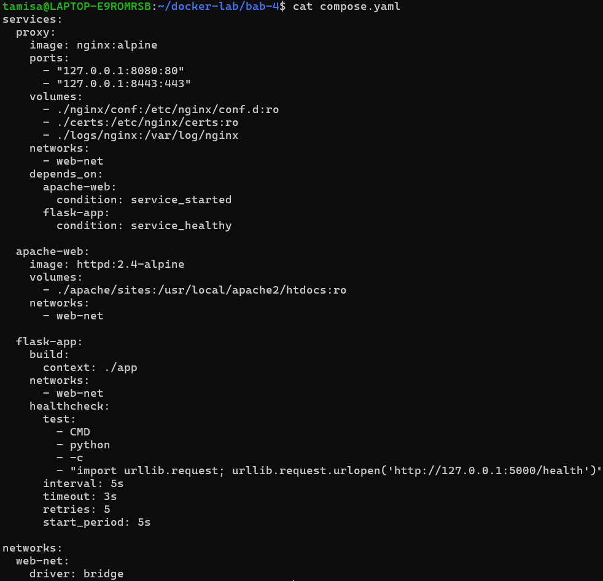

**b. `nginx/conf/default.conf`**

Blok server yang menangani redirect 80 ke 443, serta instruksi `proxy_pass` ke arah blok upstream Apache dan Flask.

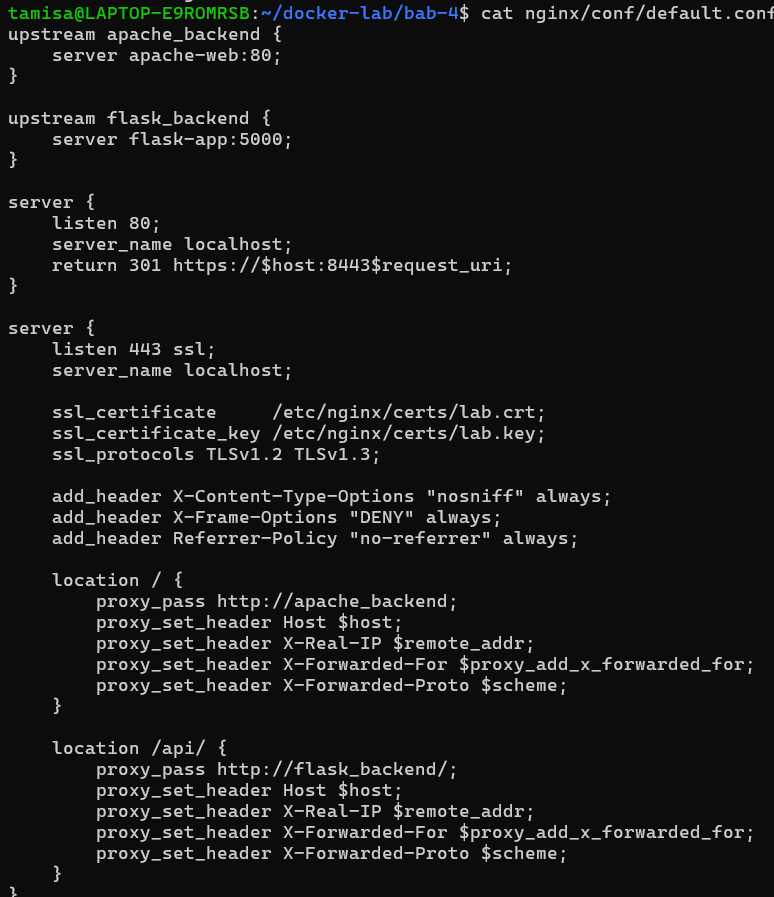

**c. Aplikasi Backend**

Membuat halaman `index.html` (untuk disajikan oleh Apache), serta dependensinya (`requirements.txt`) beserta kode API Python pada `app.py` dan berkas `Dockerfile` untuk kebutuhan build image.

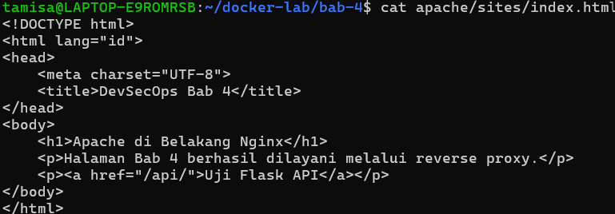

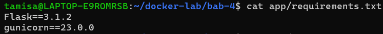

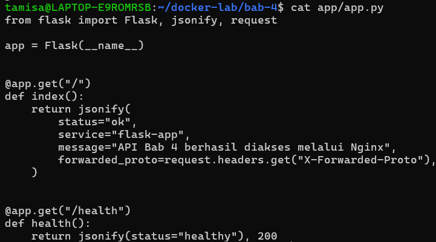

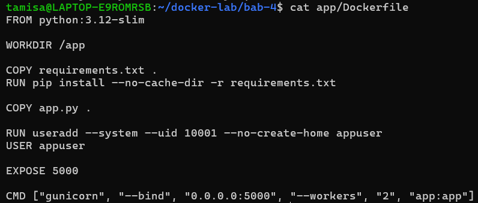

### 4.3 Dokumentasi Praktikum

**a. Validasi sintaks konfigurasi menggunakan `docker compose config`.**

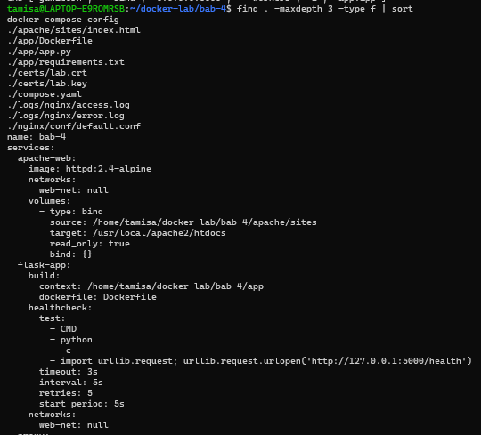

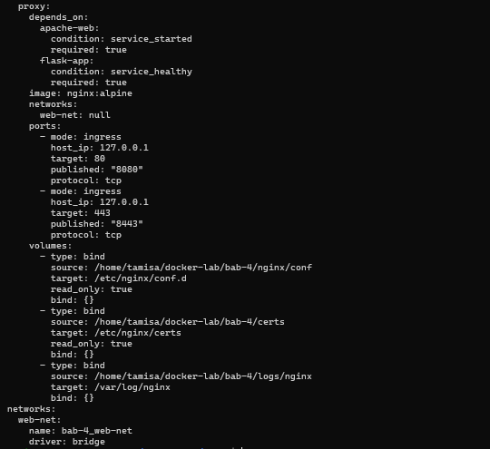

**b. Proses build image Python Flask dan eksekusi stack container.**

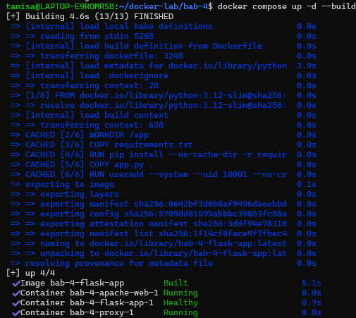

**c. Pengecekan status operasional seluruh container.**

**d. Pengujian redirect trafik HTTP ke HTTPS (Status 301).**

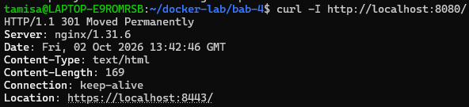

**e. Pengujian routing statis via HTTPS (akses halaman Apache) dan perutean API Flask.**

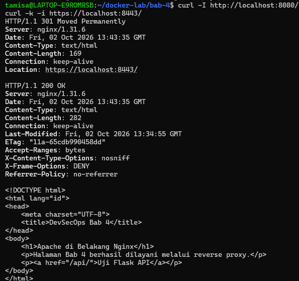

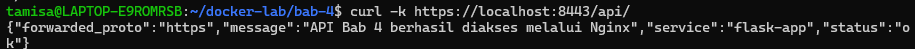

**f. Validasi handshake TLS (`openssl s_client -brief`).**

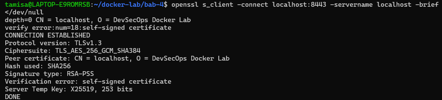

**g. Pemeriksaan Isolasi Jaringan — Inspect Network.**

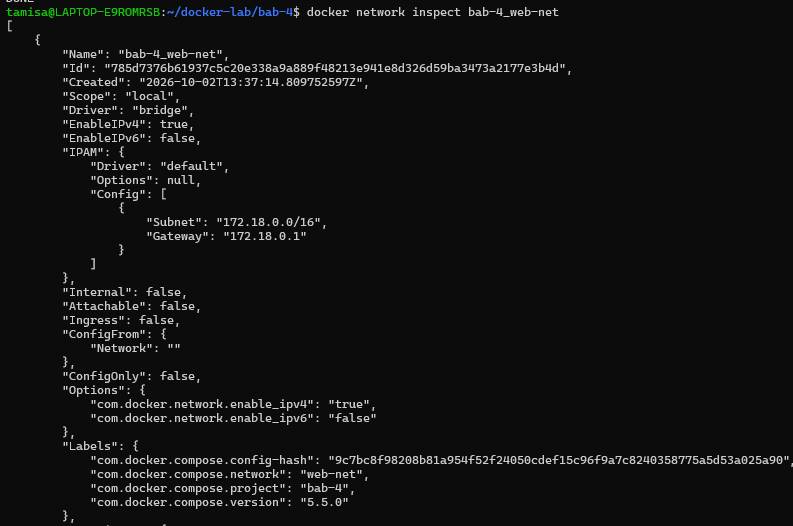

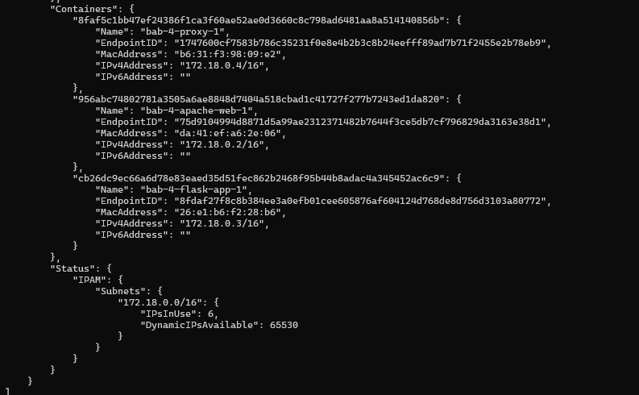

**h. Pengujian Akses Privat dari dalam Proxy ke Backend.**

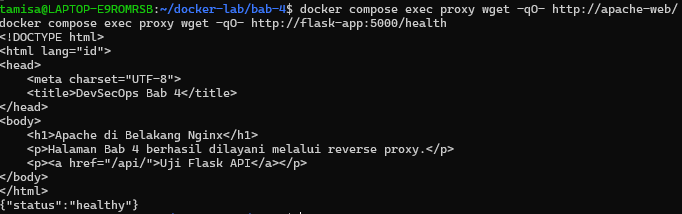

**i. Pemeriksaan access log Nginx yang tercatat secara persisten di storage OS host.**

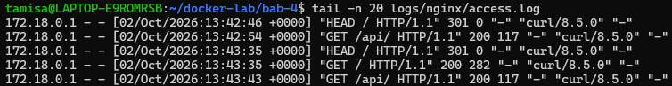

**j. Pemeriksaan Persistensi Error Log Nginx.**

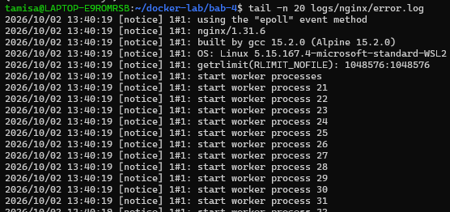

**k. Penghentian Stack Container.**

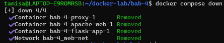

## 5. Hasil Pengujian dan Analisis

### 5.1 Hasil Pengujian

| Pemeriksaan (Check Pass) | Hasil Aktual | Status |
|---|---|---|
| Validasi sintaks `docker compose config` | Konfigurasi YAML berhasil dibaca dan dirender tanpa ada pesan error. | ✅ Terpenuhi |
| Status healthcheck Flask | Container `flask-app` sukses mencapai status (healthy) saat dicek menggunakan `docker compose ps`. | ✅ Terpenuhi |
| Uji redirect HTTP ke HTTPS (Port 8080) | Request ke port 8080 otomatis diarahkan ke HTTPS dengan balasan `HTTP/1.1 301 Moved Permanently`. | ✅ Terpenuhi |
| Akses web statis via HTTPS (Port 8443) | Nginx sukses mendekripsi koneksi dan menampilkan halaman HTML utama yang dilayani oleh backend Apache. | ✅ Terpenuhi |
| Uji routing endpoint `/api/` | Akses ke rute API berhasil mengembalikan respon JSON dari Flask (menampilkan status `ok` dan `forwarded_proto: https`). | ✅ Terpenuhi |
| Validasi negosiasi protokol TLS | Hasil pengujian `openssl s_client` membuktikan koneksi berhasil dibangun menggunakan protokol modern TLSv1.3. | ✅ Terpenuhi |
| Isolasi jaringan backend | Apache dan Flask terbukti tidak memiliki published port ke OS host, sementara pemetaan port keluar hanya dimiliki oleh Nginx. | ✅ Terpenuhi |
| Persistensi access log Nginx di host | Riwayat request klien (seperti IP, waktu, dan method HTTP) tersimpan rapi di dalam file `access.log` pada direktori OS host. | ✅ Terpenuhi |

### 5.2 Analisis Hasil

Hasil pengujian pada tabel di atas membuktikan penerapan utama dari arsitektur microservices dan containerization. Nginx berhasil menjalankan perannya sebagai reverse proxy yang mengambil alih tugas komunikasi eksternal dan proses terminasi TLS pada port 8443. Pengalihan dari HTTP (8080) ke HTTPS berjalan otomatis, memaksa client menggunakan jalur yang aman (terenkripsi). Pada sisi backend, pembagian workload berjalan dengan baik. Request ke root path (`/`) langsung di-routing ke Apache untuk menampilkan halaman web statis, sedangkan trafik ke endpoint `/api/` diteruskan ke framework Flask. Berkat mekanisme TLS Offloading di Nginx, kinerja server Flask dan Apache menjadi jauh lebih ringan karena mereka tidak perlu melakukan proses dekripsi ulang. Komunikasi antarlayanan di dalam Docker network (`web-net`) menggunakan protokol HTTP biasa, namun sudah terjamin aman secara arsitektur karena terisolasi penuh dari akses internet publik.

### 5.3 Analisis Ancaman (Threat Modeling)

| Aset yang Dilindungi | Ancaman | Mitigasi yang Diterapkan di Lab | Dampak jika Terjadi |
|---|---|---|---|
| Kunci Privat TLS (`lab.key`) | Kebocoran kunci karena disimpan di image docker publik, salah commit ke GitHub, atau izin baca file terlalu luas di OS host. | Izin file dikunci (`chmod 600`) dan dipetakan ke Nginx dengan atribut Read-Only (`:ro`). | Serangan Man-in-the-Middle (MitM); peretas bisa menyadap dan membaca data rahasia HTTPS klien. |
| Lingkungan Root Container | Eksekusi kode acak (RCE) apabila peretas menembus aplikasi Flask. | Dockerfile Flask mengatur aplikasi dijalankan menggunakan entitas non-root (UID 10001). | Peretas tidak bisa mengambil alih total sistem/container jika eksploitasi terjadi. |

### 5.4 Analisis Masalah dan Solusi (Troubleshooting)

Dalam implementasi arsitektur multi-container, salah satu kendala operasional yang sering terjadi saat tahap startup adalah *race condition*. Jika Nginx dijalankan tepat bersamaan dengan backend Flask, Nginx akan langsung mencoba me-resolve upstream `flask-app:5000`. Namun, karena Gunicorn dan framework Python membutuhkan waktu beberapa detik untuk proses binding ke port jaringan, Nginx akan gagal meneruskan koneksi dan menghasilkan error **502 Bad Gateway**.

**Solusi:**
Diagnosis awal dilakukan dengan memeriksa log pada container proxy. Pendekatan paling efektif untuk mengatasi hal ini adalah dengan menambahkan parameter healthcheck pada service Flask, lalu mengatur dependensi Nginx di `compose.yaml` menjadi `depends_on: flask-app: condition: service_healthy`. Konfigurasi ini menginstruksikan Docker daemon untuk menahan proses inisialisasi Nginx sampai endpoint health Flask membalas dengan status 200 (healthy), sehingga masalah 502 dapat dihindari sepenuhnya sejak awal penjalanan stack.

### 5.5 Analisis Keamanan dan Rekomendasi

Apabila arsitektur laboratorium ini akan diimplementasikan pada lingkungan produksi, terdapat beberapa peningkatan keamanan yang direkomendasikan:

1. **Penggunaan Certificate Authority (CA) Resmi**
   Mengganti sertifikat self-signed dengan sertifikat dari CA publik terpercaya (seperti Let's Encrypt melalui agen Certbot). Hal ini penting agar browser klien dapat memvalidasi identitas server secara otomatis tanpa memunculkan peringatan bahaya.
2. **Manajemen Secret Berbasis Memori**
   Praktik bind mount untuk file `lab.key` sangat berisiko jika diterapkan di production. Pengelolaan secret idealnya menggunakan layanan terpusat seperti Docker Swarm Secrets atau HashiCorp Vault. Dengan mekanisme ini, kunci akan dimuat langsung ke dalam RAM (tmpfs) di container, sehingga meminimalisir risiko pencurian jika OS host diretas.
3. **Penerapan Security Headers (HSTS & CSP)**
   Mengonfigurasi Nginx untuk menambahkan header keamanan, khususnya Strict-Transport-Security (HSTS), guna mencegah peretas memaksakan koneksi turun kembali ke protokol HTTP (*downgrade attack*).

## 6. Evaluasi dan Latihan Mandiri

**1) Mengapa reverse proxy tidak seharusnya menjalankan semua logic aplikasi?**

Tugas utama reverse proxy difokuskan pada boundary jaringan, seperti menangani konkurensi I/O yang tinggi, terminasi TLS, dan routing HTTP. Jika dibebankan komputasi yang berat ke dalamnya, hal tersebut akan melanggar prinsip *Separation of Concerns*. Akibatnya, event loop Nginx akan terhambat, menciptakan *single point of failure*, serta menyulitkan scaling server backend secara independen.

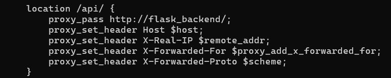

Konfigurasi di atas (`nginx/conf/default.conf`) memvalidasi bahwa Nginx hanya meneruskan rute (`proxy_pass`) ke backend tanpa memproses logika program atau data JSON di dalamnya.

**2) Apa perbedaan TLS termination dan end-to-end TLS?**

Pada TLS termination (seperti pada praktikum ini), enkripsi data dibuka (didekripsi) di Nginx, dan komunikasi dari Nginx menuju backend berjalan tanpa enkripsi (plain HTTP) di jaringan privat lokal. Sedangkan End-to-End TLS mempertahankan perlindungan sandi secara penuh dari browser klien sampai ke container backend, yang jauh lebih aman untuk model Zero Trust namun menuntut overhead CPU ganda.

Pengujian ini memvalidasi TLS Termination, di mana koneksi internal dari proxy ke backend murni menggunakan protokol HTTP biasa tanpa enkripsi.

**3) Bagaimana cara mengisolasi backend agar tidak langsung diakses dari host?**

Penerapan isolasi dilakukan dengan secara eksplisit tidak mempublikasikan port eksternal. Pada file Compose, blok deklarasi `ports:` (pemetaan ke host) hanya diberikan kepada service Nginx. Sementara itu, service Apache dan Flask hanya disambungkan ke internal `networks: [web-net]`. Dengan metode ini, entitas backend sepenuhnya terisolasi dan tidak bisa dijangkau oleh OS Host maupun internet publik secara langsung.

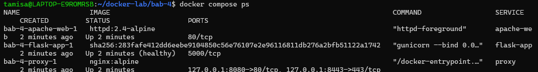

Kolom PORTS memvalidasi bahwa hanya container proxy (Nginx) yang memiliki port eksternal (8080 dan 8443), sedangkan Apache dan Flask diisolasi.

**4) Apa konsekuensi menyimpan private key TLS di bind mount?**

Konsekuensi terbesarnya adalah kerentanan perpindahan file. Karena file private key menetap secara fisik pada direktori OS Host, maka keamanan kunci tersebut sepenuhnya bergantung pada konfigurasi permission host. Adanya kesalahan hak akses, pencadangan folder yang tidak tersandi, atau kelalaian saat melakukan commit Git, dapat mengakibatkan kredensial utama web server ini jatuh ke pihak yang salah.

Melalui bind mount pada `compose.yaml`, kunci privat diletakkan langsung di OS host, sehingga penting untuk memastikan hak akses lokalnya dikunci rapat menggunakan `chmod 600`.

**5) Bandingkan log Nginx dan log Apache dari sisi format dan kegunaan debugging.**

Secara desain, format `access.log` bersifat ringkas, terpusat, dan seragam, sangat cocok dikonsumsi oleh tools monitoring untuk melacak sumber IP, rute proxy, dan performa respon jaringan. Sebaliknya, Apache memiliki error log yang sangat terperinci. Apache mampu menampilkan error log hingga menembus level modul spesifik dan thread worker, yang membuatnya lebih informatif saat harus memecahkan bug internal server.

Dari output di atas, log Nginx mencatat aktivitas secara terstruktur sehingga mudah digunakan untuk memantau rute akses klien dan status HTTP.

## 7. Kesimpulan

Praktikum Bab 4 ini berhasil membuktikan efektivitas pola desain *decoupling* pada arsitektur web service. Beban kerja sistem sukses dipisahkan menjadi tiga komponen yang saling independen, yaitu reverse proxy dan terminasi TLS (Nginx), web server untuk konten statis (Apache), serta backend API dinamis (Flask). Mekanisme enkripsi TLS, routing berbasis path, dan healthcheck otomatis telah berfungsi dengan baik tanpa perlu mengekspos port internal ke jaringan luar. Hasil praktikum ini menunjukkan bahwa penentuan *Trust Boundary* yang jelas merupakan fondasi penting dalam penerapan DevSecOps. Ke depannya, implementasi di lingkungan production perlu menyertakan peningkatan keamanan, khususnya penggunaan sertifikat dari Public CA yang valid serta manajemen secret (seperti private key) yang berjalan langsung di dalam memori.

---

⬅️ [Kembali ke daftar praktikum](../README.md)
