# Laporan Praktikum Workshop DevOps

## Pertemuan 5 — PostgreSQL, pgAdmin, Volume, Backup, dan Restore

| | |
|---|---|
| **Nama** | Tamisa Ulinda Marpaung |
| **NRP** | 3126640048 |
| **Mata Kuliah** | Workshop DevOps |
| **Program Studi** | D4 Lanjut Jenjang Teknik Informatika |
| **Institusi** | Politeknik Elektronika Negeri Surabaya |
| **Tahun** | 2026 |

📄 Versi PDF: [laporan.pdf](laporan.pdf)

---

## Daftar Isi

1. [Tujuan Praktikum](#1-tujuan-praktikum)
2. [Dasar Teori](#2-dasar-teori)
3. [Alat dan Lingkungan](#3-alat-dan-lingkungan)
4. [Langkah Praktikum](#4-langkah-praktikum)
5. [Hasil Pengujian dan Analisis](#5-hasil-pengujian-dan-analisis)
6. [Evaluasi dan Latihan Mandiri](#6-evaluasi-dan-latihan-mandiri)
7. [Kesimpulan](#7-kesimpulan)
8. [AI Usage Statement](#ai-usage-statement)

---

## 1. Tujuan Praktikum

Praktikum Bab 5 bertujuan untuk memahami manajemen *stateful service* berbasis container menggunakan PostgreSQL dan pgAdmin4. Berbeda dengan layanan *stateless* (seperti web server), data pada database harus tetap tersimpan secara aman meskipun container dihapus atau di-restart. Praktikum ini mencakup konfigurasi environment variables, pembuatan persistent volume, inisialisasi skema awal (*init script*), serta simulasi operasional seperti logical backup dan restore.

Kompetensi yang diharapkan dari praktikum ini adalah sebagai berikut:

- a. Menjalankan PostgreSQL dengan konfigurasi berbasis environment variable dan volume persisten.
- b. Menginisialisasi database menggunakan file SQL pada `docker-entrypoint-initdb.d`.
- c. Mengakses database melalui `psql` dan pgAdmin4.
- d. Melakukan backup dan restore menggunakan `pg_dump` dan `pg_restore`.
- e. Menerapkan healthcheck pada service PostgreSQL.
- f. Mengidentifikasi celah keamanan dari penyimpanan kredensial pada file `.env` beserta solusi perbaikannya.

## 2. Dasar Teori

### 2.1 Stateful Container dan Persistensi

Secara fundamental, container bersifat sementara. Ketika sebuah container dihapus, semua data yang berada di *writable layer* bawaannya akan ikut terhapus. Untuk menjalankan sistem stateful seperti PostgreSQL, data harus diisolasi ke dalam persistent volume (baik berupa named volume maupun bind mount). Pendekatan ini memastikan bahwa direktori penyimpanan utama database (seperti `/var/lib/postgresql/data`) tetap utuh di sisi OS host meskipun container di-restart atau dihentikan menggunakan perintah `docker compose down`. Namun, perlu diperhatikan bahwa eksekusi perintah `docker compose down -v` akan menghapus container beserta volume yang terpasang, sehingga perintah ini sangat dihindari di lingkungan production agar data tidak hilang secara permanen.

### 2.2 Backup dan Restore Logis

Memiliki persistent volume bukan berarti sistem sudah memiliki perlindungan data yang utuh. Volume hanya melindungi data dari matinya container, tetapi rentan terhadap korupsi data internal atau *human error* (seperti tidak sengaja menghapus tabel). Oleh karena itu, diperlukan logical backup menggunakan utilitas bawaan seperti `pg_dump` untuk mengekstrak data menjadi arsip SQL mandiri. Backup ini juga harus diuji melalui proses restore (`pg_restore`) ke database terpisah untuk memvalidasi integritas datanya.

## 3. Alat dan Lingkungan

| Komponen | Hasil Identifikasi |
|---|---|
| Operating system | Ubuntu 24.04.1 LTS (via WSL2) |
| Pengguna eksekusi | tamisa |
| Direktori kerja | `~/docker-lab/bab-5` |
| Docker Compose | Terpasang (v5.5.0), integrasi V2 aktif |
| Base Images | `postgres:16-alpine`, `dpage/pgadmin4:latest` |

## 4. Langkah Praktikum

### 4.1 Persiapan Direktori dan Skrip Pendukung

Tahap awal praktikum dimulai dengan membuat struktur direktori dan file konfigurasi pendukung, meliputi:

**a.** Membuat struktur folder kerja utama beserta sub-direktorinya, yaitu `init`, `backup`, `pgadmin`, dan `scripts`.

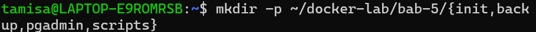

**b.** Membuat file `.env` untuk menyimpan konfigurasi environment dan kredensial database. File ini kemudian dibatasi hak aksesnya menggunakan perintah `chmod 600`.

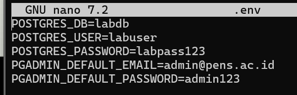

**c.** Mengatur file `.gitignore` agar file kredensial (`.env`) dan arsip backup (`*.dump`) tidak ikut ter-push ke repositori Git.

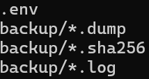

**d.** Membuat file `compose.yaml` untuk mengonfigurasi dan menjalankan container `postgres-db` serta `pgadmin`.

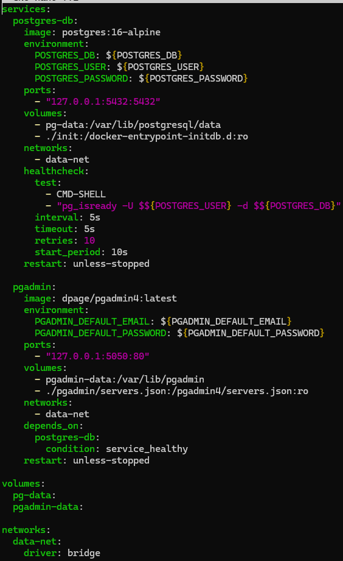

**e.** Membuat init script berupa file `init/01-schema.sql` untuk eksekusi pembuatan tabel `students` beserta isi data awalnya.

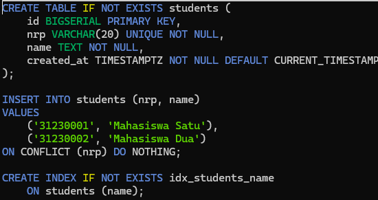

**f.** Membuat file konfigurasi `pgadmin/servers.json` agar server PostgreSQL nantinya otomatis terbaca di UI pgAdmin tanpa perlu di-setting manual.

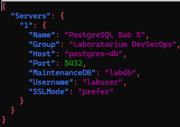

**g.** Membuat `backup.sh` dan `restore-test.sh` untuk mempermudah eksekusi logical backup dan pengujian restore.

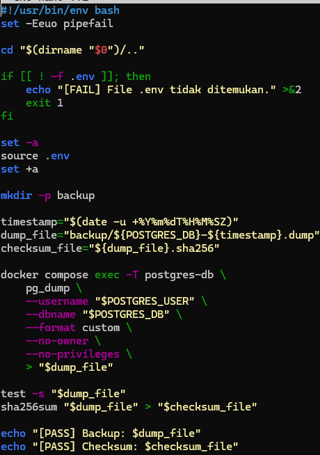

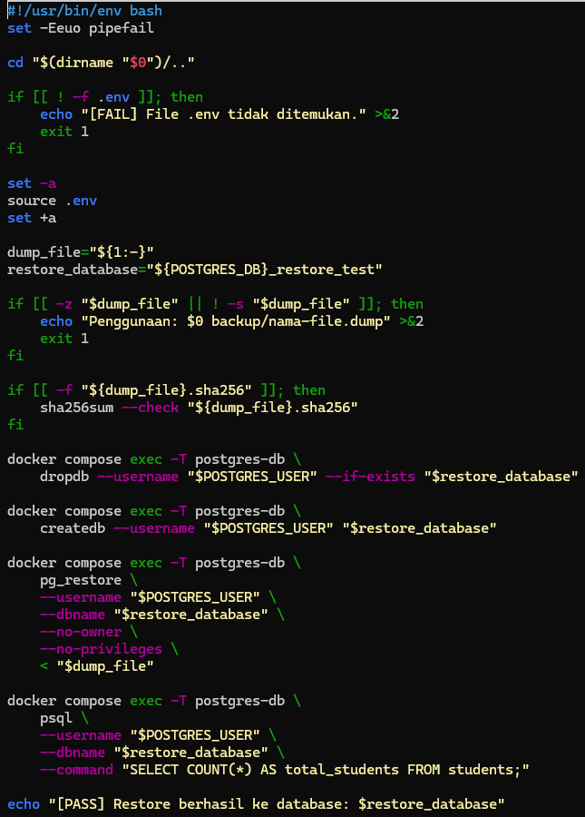

### 4.2 Permission dan Validasi Konfigurasi

Memberikan hak eksekusi (`chmod +x`) pada skrip backup/restore. Dilanjutkan dengan eksekusi `docker compose config` untuk memvalidasi tidak ada eror sintaksis pada file YAML.

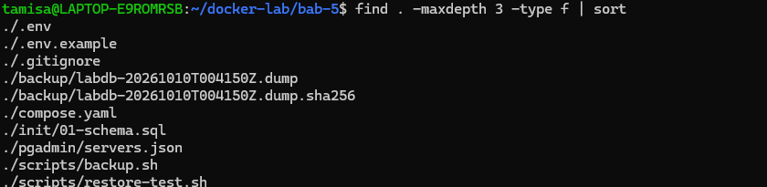

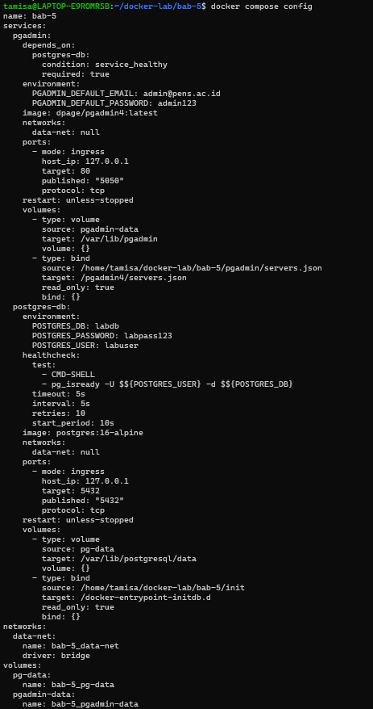

Service yang diharapkan:

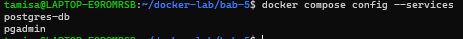

### 4.3 Menjalankan Stack

Mengeksekusi `docker compose up -d`. Memantau status menggunakan `docker compose ps` hingga `postgres-db` mencapai status (healthy).

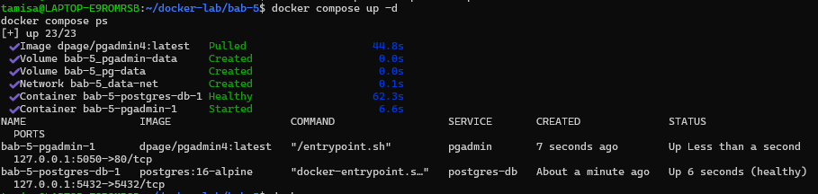

Setelah PostgreSQL berstatus healthy, akses dashboard antarmuka pgAdmin melalui browser di `http://localhost:5050`. Login menggunakan nilai kredensial `PGADMIN_DEFAULT_EMAIL` dan `PGADMIN_DEFAULT_PASSWORD` yang sudah di-set pada file `.env`.

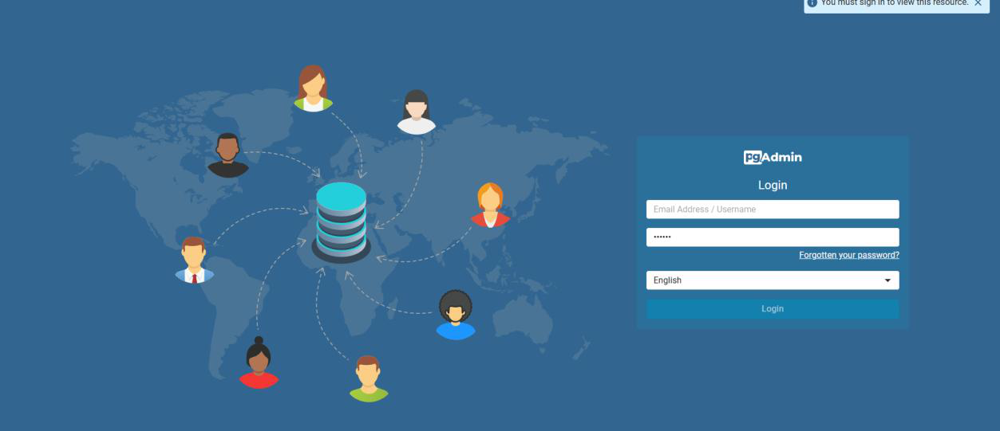

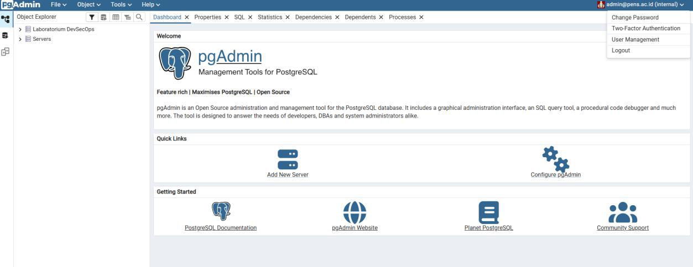

Di panel sebelah kiri, terlihat server bernama **PostgreSQL Bab 5**, yang sudah diatur pada file `servers.json`. Klik server tersebut dan masukkan password database (`labpass123`).

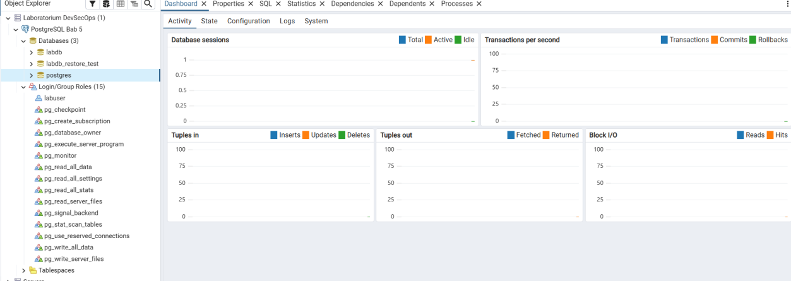

### 4.4 Pengujian Schema dan Data Awal

Tahap ini bertujuan untuk memverifikasi apakah init script (`01-schema.sql`) berhasil dieksekusi secara otomatis saat volume masih kosong. Jalankan perintah `\dt` dan kueri `SELECT` via interactive shell `psql` ke dalam container PostgreSQL.

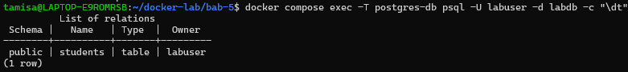

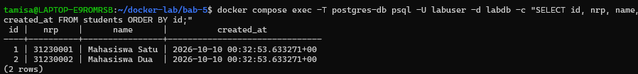

Output terminal menampilkan daftar tabel `students` beserta dua baris data awal ("Mahasiswa Satu" dan "Mahasiswa Dua").

### 4.5 Pengujian Persistensi Volume

Untuk membuktikan bahwa arsitektur stateful ini berfungsi, inject satu record data baru (Mahasiswa Tiga) ke dalam tabel.

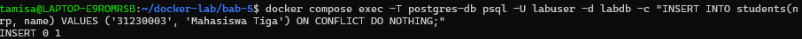

Selanjutnya, disimulasikan downtime dengan mematikan container melalui perintah `docker compose down` (tanpa menghapus volume).

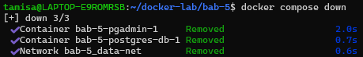

Setelah mati, hidupkan kembali dengan `docker compose up -d`.

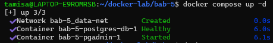

Lakukan kueri `SELECT` untuk mengecek datanya.

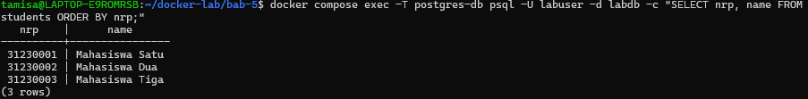

Hasilnya, record "Mahasiswa Tiga" tetap tersedia. Hal ini membuktikan bahwa siklus hidup data sukses dipisahkan dari siklus hidup container, karena penggunaan named volume.

### 4.6 Backup

Skrip `./scripts/backup.sh` dieksekusi untuk melakukan logical backup, menggunakan utilitas `pg_dump`.

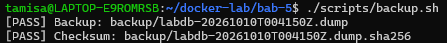

Untuk memvalidasi bahwa file dump berhasil dibuat dan tidak corrupt, cek ukuran filenya (`ls -lh`).

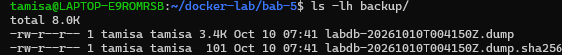

Kemudian periksa integritas datanya menggunakan validasi algoritma hash (`sha256sum --check`).

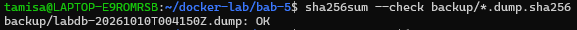

### 4.7 Pengujian Restore

Sebuah file backup belum bisa dipercaya sebelum diuji coba. Pada bagian ini file dump terbaru diseleksi, lalu mengeksekusi `./scripts/restore-test.sh` untuk merekonstruksi data ke dalam database uji yang terisolasi (`labdb_restore_test`).

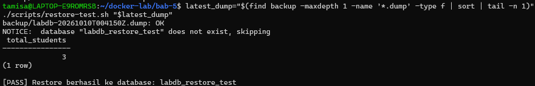

Hasil menunjukkan jumlah baris sukses dikembalikan utuh (3 records) sesuai dengan kondisi sumbernya.

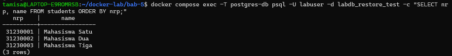

### 4.8 Monitoring

Untuk memantau kesehatan operasional dan utilisasi resource, jalankan beberapa perintah berikut: `docker compose ps` untuk melihat state container, `docker compose logs --tail 100` untuk mengecek jejak log aktivitas database, serta `docker system df -v` untuk memantau kapasitas storage yang terpakai oleh volume Docker di OS host.

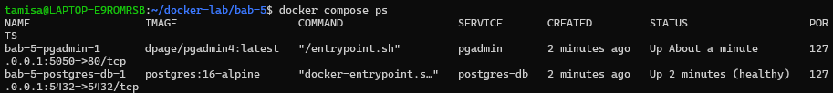

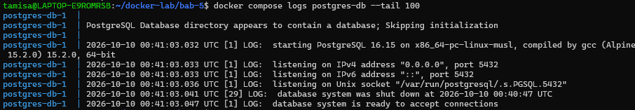

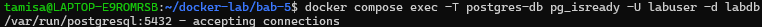

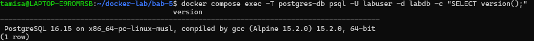

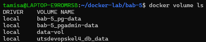

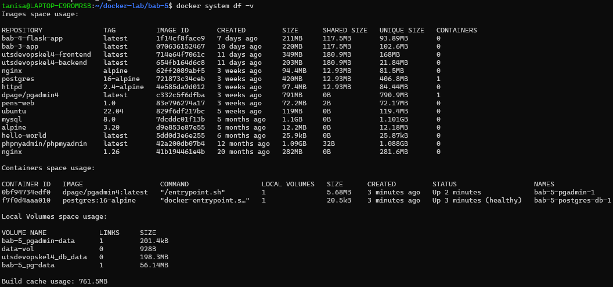

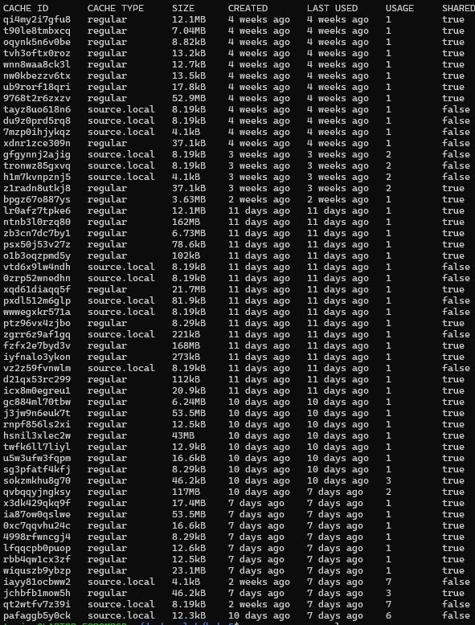

### 4.9 Cleanup

Langkah terakhir adalah melakukan drop pada database testing agar tidak membebani storage.

Selanjutnya, eksekusi perintah `docker compose down` untuk menghentikan layanan container dan menghapus jaringan (network) internal. Dengan perintah ini, volume yang berisi data asli akan tetap aman dan tersimpan utuh di OS host.

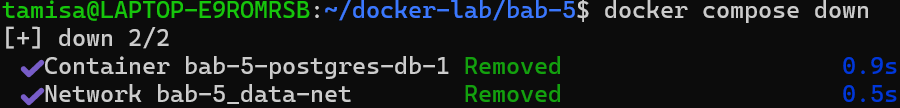

## 5. Hasil Pengujian dan Analisis

### 5.1 Hasil Pengujian

| Parameter Checklist (PASS) | Hasil Aktual | Status |
|---|---|---|
| `docker compose config` tidak menghasilkan eror | File YAML berhasil dibaca oleh Docker tanpa ada pesan error sintaks. | ✅ Terpenuhi |
| PostgreSQL berstatus healthy | Container `postgres-db` berhasil melewati proses healthcheck dan mendapat status (healthy). | ✅ Terpenuhi |
| Tabel `students` dan data awal tersedia | Tabel berhasil ter-create otomatis dan eksekusi query `SELECT` menampilkan 2 baris data sesuai init script. | ✅ Terpenuhi |
| pgAdmin dapat terhubung menggunakan hostname | pgAdmin berhasil login dan terhubung ke database menggunakan hostname `postgres-db`. | ✅ Terpenuhi |
| Data persisten walau di-down dan up | Data "Mahasiswa Tiga" yang baru di-insert tidak hilang setelah container dimatikan (down) dan dinyalakan lagi (up). | ✅ Terpenuhi |
| Backup dump berukuran lebih dari nol | Hasil pengecekan `ls -lh` menunjukkan file `.dump` berhasil di-generate dan ukurannya tidak 0 byte. | ✅ Terpenuhi |
| Checksum backup valid | Eksekusi `sha256sum` memunculkan status OK, yang memastikan file backup utuh dan tidak corrupt. | ✅ Terpenuhi |
| Restore berhasil ke `labdb_restore_test` | Proses restore file `.dump` ke database pengujian (`labdb_restore_test`) berjalan sukses tanpa menimpa database utama. | ✅ Terpenuhi |
| Jumlah dan isi record hasil restore sesuai | Hasil kueri pada database restore menunjukkan jumlah dan isi data (3 baris) sama persis dengan database sumbernya. | ✅ Terpenuhi |
| Kredensial & dump tidak masuk repositori Git | Aturan pada file `.gitignore` berhasil memblokir file `.env` dan `.dump` agar tidak ikut ter-commit ke Git. | ✅ Terpenuhi |

### 5.2 Analisis Ancaman, Masalah, dan Rekomendasi

**a. Analisis Masalah & Troubleshooting**

Pada fase awal startup, interface browser pgAdmin menolak koneksi (`ERR_CONNECTION_REFUSED`), dan container `pgadmin` terjebak dalam *crash loop* berstatus `Restarting`.

**Diagnosis dan solusi:**
Pemeriksaan log menggunakan `docker compose logs pgadmin` menunjukkan adanya penolakan validasi dari image pgAdmin karena variabel `PGADMIN_DEFAULT_EMAIL` (`admin@example.local`) menggunakan *reserved domain* (`.local`). Solusinya adalah mengubah kredensial `.env` ke domain akademis standar (`admin@pens.ac.id`) dan mengeksekusi ulang stack.

### 5.3 Analisis Risiko Keamanan & Operasional (Threat Modeling)

**a. Risiko Kredensial (`.env`)**

Praktik mem-passing kata sandi melalui environment variables (seperti `POSTGRES_PASSWORD`) sangat rawan terekspos (plaintext). Kredensial tersebut dapat dengan mudah disadap oleh siapa saja yang memiliki hak read ke log aplikasi yang crash, ataupun pengguna yang menjalankan perintah `docker inspect`.

Jika arsitektur ini akan dipromosikan ke tahap production, sangat direkomendasikan untuk beralih dari mekanisme `.env` ke layanan secret management khusus seperti Docker Secrets atau HashiCorp Vault. Dengan metode tersebut, secret key akan dimuat secara dinamis langsung ke dalam memori sementara (tmpfs) dari container yang membutuhkan, sehingga jejak password tidak akan pernah tersimpan di sistem file fisik OS.

### 5.4 Pertanyaan Tambahan: Manajemen Kredensial Database

**Bagaimana sebaiknya menyimpan kredensial di database?**

Dalam arsitektur praktikum ini, konfigurasi password (`POSTGRES_PASSWORD`) disimpan di dalam file `.env` dan dikunci dengan hak akses `chmod 600`. Meskipun hal ini cukup untuk lingkungan lokal (lab), menempatkan kredensial di dalam environment variables sangat berisiko dan tidak direkomendasikan untuk lingkungan production.

**Analisis Risiko:**
Menyimpan data sensitif melalui environment variables memiliki kelemahan bawaan pada ekosistem Docker. Nilai kredensial tersebut dapat dengan mudah terekspos secara plaintext ketika perintah `docker inspect` dijalankan pada container terkait. Selain itu, variabel ini juga rawan bocor secara tidak sengaja melalui crash logs aplikasi, dashboard monitoring, atau jika penyerang berhasil mendapatkan celah Remote Code Execution (RCE) lalu membaca file `/proc/self/environ` dari dalam container.

**Rekomendasi:**
Sebagai *best practice*, manajemen secret harus dipisahkan dari konfigurasi environment biasa. Solusi yang lebih aman adalah menggunakan layanan manajemen kunci seperti Docker Secrets (pada Docker Swarm) atau HashiCorp Vault. Melalui pendekatan ini, kredensial tidak akan pernah disimpan secara permanen di media penyimpanan (disk). Kredensial hanya akan dimuat secara dinamis ke dalam memori RAM sementara (tmpfs) milik container yang memiliki hak akses. Ketika container dihentikan, data password tersebut akan otomatis hilang dari memori, sehingga celah pencurian data kredensial dapat diminimalisir.

## 6. Evaluasi dan Latihan Mandiri

**1) Mengapa init script tidak dijalankan ulang saat volume lama masih ada?**

Image resmi PostgreSQL dirancang agar tidak menimpa skema data yang sudah beroperasi di fase production. Sistem akan otomatis melewati proses eksekusi skrip di dalam direktori `/docker-entrypoint-initdb.d/` apabila terdeteksi bahwa direktori `PGDATA` sudah terisi dengan struktur file database.

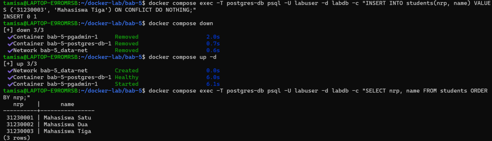

Output terminal di atas membuktikan bahwa skrip `01-schema.sql` tidak dieksekusi ulang saat container di-restart. Buktinya, data "Mahasiswa Tiga" yang di-insert belakangan tetap aman. Jika init script dipaksa jalan lagi, data pasti akan mengalami bentrok atau tabelnya ter-reset ke kondisi awal.

**2) Apa risiko menaruh password database pada `docker-compose.yml`?**

Menuliskan kata sandi secara mentah (hardcode/plaintext) di dalam file YAML akan mengekspos kredensial tersebut secara permanen ke dalam riwayat repositori Git. Jika source code bocor atau repositorinya keliru di-set ke publik, akses database akan langsung diretas.

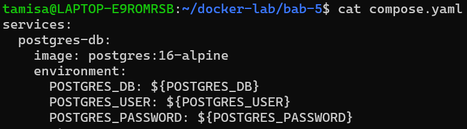

Gambar di atas menunjukkan penerapan *secret abstraction*. Password tidak di-passing secara mentah ke dalam file YAML, melainkan dipanggil melalui variabel lingkungan (`${POSTGRES_PASSWORD}`). File `.env` yang menyimpan nilai password aslinya juga telah dicegah agar tidak masuk ke repositori dengan menambahkannya ke dalam file `.gitignore`.

**3) Bagaimana cara membuktikan backup dapat dipulihkan?**

Dengan melakukan simulasi restore ke instance atau database terpisah, lalu mengecek apakah jumlah baris (record) dan strukturnya sudah utuh. File backup yang hanya disimpan di storage tanpa pernah diuji coba proses pemulihannya tidak bisa sepenuhnya diandalkan, karena file tersebut bisa saja corrupt atau gagal diekstrak saat dibutuhkan.

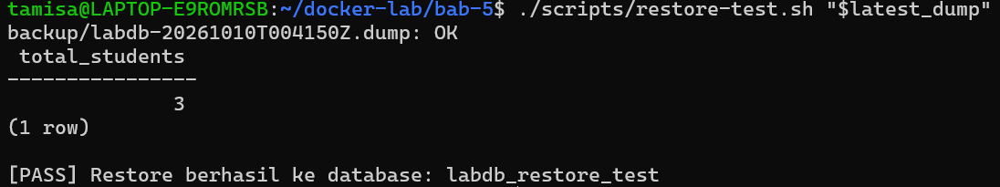

Tangkapan layar ini adalah bukti nyata bahwa file backup yang dihasilkan benar-benar valid secara logis. Skrip berhasil merekonstruksi ulang isi file `.dump` menjadi sebuah database utuh (`labdb_restore_test`) tanpa merusak database sumbernya.

**4) Apa bedanya logical backup `pg_dump` dan backup filesystem volume mentah?**

Backup filesystem mentah (menyalin folder volume secara langsung dari OS host) sangat berisiko menghasilkan data yang corrupt jika disalin saat proses I/O database masih berjalan. Selain itu, metode ini rentan memicu masalah kompatibilitas apabila dipindahkan ke OS atau versi PostgreSQL yang berbeda. Sebaliknya, logical backup (menggunakan `pg_dump`) mengekstrak struktur dan isi database menjadi file arsip atau kueri SQL murni, sehingga hasilnya jauh lebih stabil dan fleksibel untuk dipulihkan di berbagai environment.

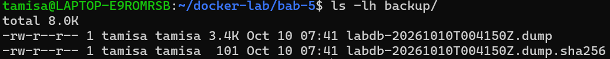

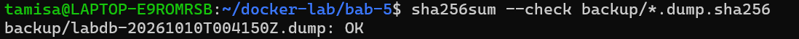

Berdasarkan gambar di atas, pengeksekusian metode logical backup (`pg_dump`) terbukti menghasilkan satu file arsip berekstensi `.dump` yang ringkas. Proses ini juga diiringi dengan pembuatan file validasi `.sha256` untuk memastikan integritas data dan memvalidasi bahwa file hasil backup tidak corrupt.

**5) Apa dampak `docker compose down -v` terhadap database?**

Parameter `-v` memaksa penghapusan paksa named volume terkait. Akibatnya, seluruh tabel, data mahasiswa, index, dan konfigurasi operasional PostgreSQL akan terhapus secara permanen dari storage host.

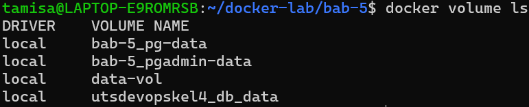

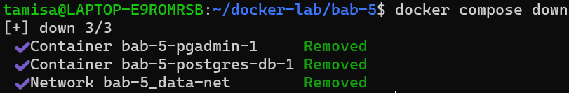

Bukti di atas menunjukkan penerapan *best practice* operasional saat melakukan cleanup layanan. Parameter `-v` secara eksplisit tidak digunakan saat mematikan container, sehingga data di dalam volume `pg-data` dipastikan tetap aman di direktori OS host.

## 7. Kesimpulan

Praktikum Bab 5 ini berhasil mengimplementasikan layanan stateful (PostgreSQL) di dalam lingkungan container. Dengan memanfaatkan named volume, siklus hidup container dapat dipisahkan dari penyimpanan data itu sendiri. Hal ini memastikan data tetap aman meskipun container di-restart atau dibuat ulang (*re-deployment*).

Pengujian operasional yang telah dilakukan, mulai dari *auto-initialization* skema tabel, penerapan healthcheck, hingga eksekusi logical backup dan restore, telah menunjukkan bahwa manajemen database di lingkungan Docker memerlukan mekanisme pencadangan yang benar-benar teruji. Dari aspek keamanan DevSecOps, menyimpan kredensial pada environment variables terbukti masih rentan terhadap kebocoran informasi. Oleh karena itu, penerapan secret management berbasis memori (seperti menggunakan Docker Secrets atau HashiCorp Vault) sangat diwajibkan apabila arsitektur ini akan diimplementasikan ke lingkungan production.

## AI Usage Statement

Dalam penyusunan laporan Bab 5 ini, AI digunakan secara terbatas sebagai asisten diskusi untuk memperdalam pemahaman konsep operasional stateful service, menelusuri akar masalah (troubleshooting) saat terjadi crash loop pada pgAdmin, serta menyempurnakan struktur tata bahasa laporan. Adapun untuk keseluruhan eksekusi teknis, mulai dari penulisan script, eksekusi perintah Docker, pengujian persistensi volume, pengujian logical backup/restore, hingga pengambilan screenshot, sepenuhnya dilakukan secara mandiri di dalam environment WSL lokal guna memastikan pemahaman secara menyeluruh.

---

⬅️ [Kembali ke daftar praktikum](../README.md)
